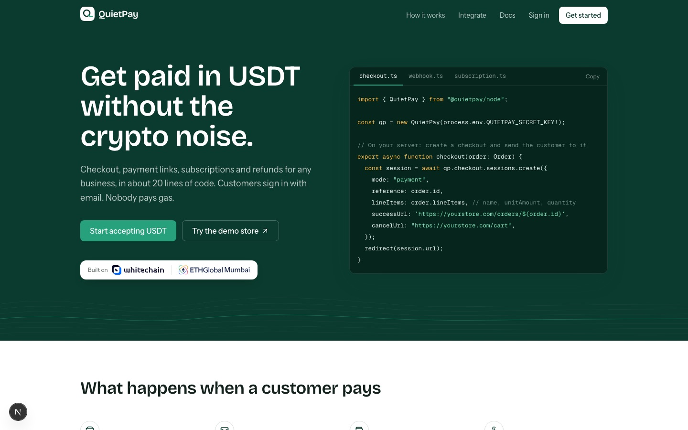
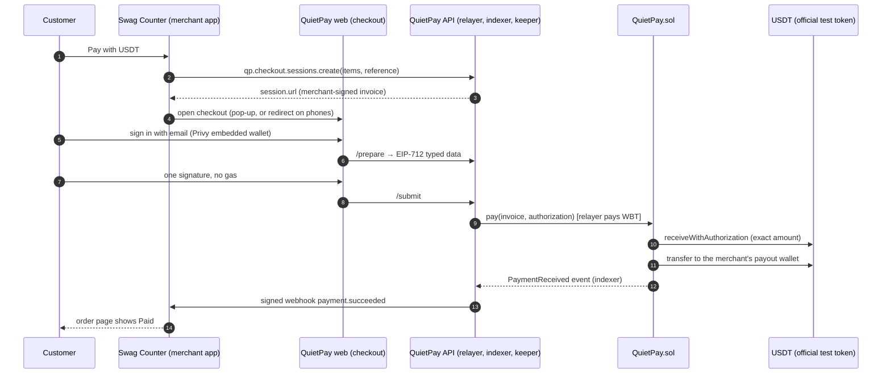
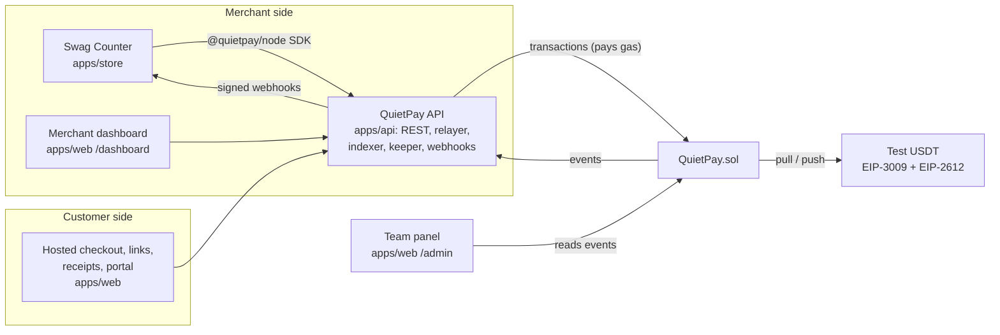
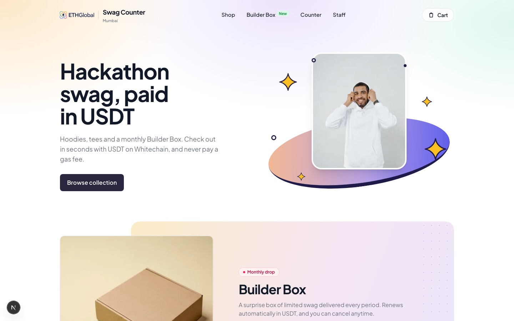
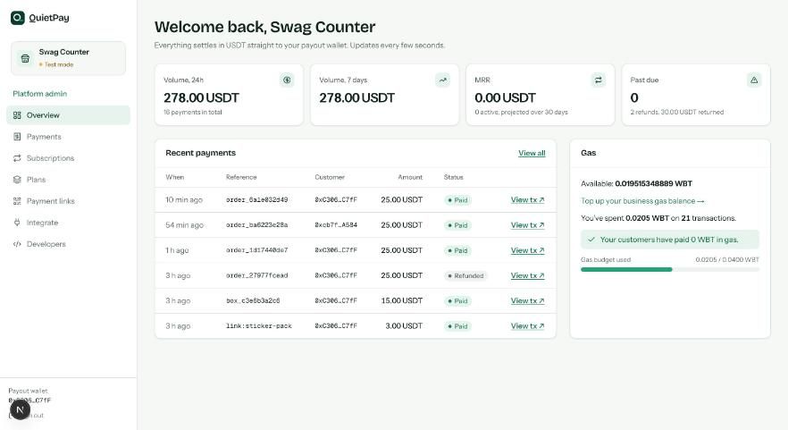
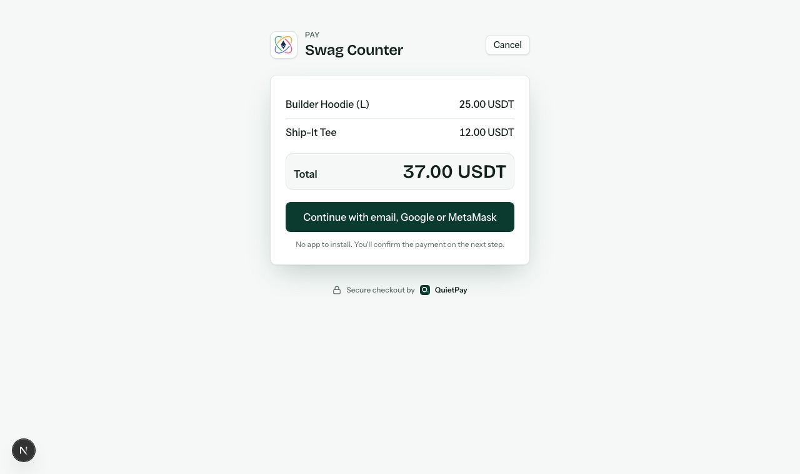
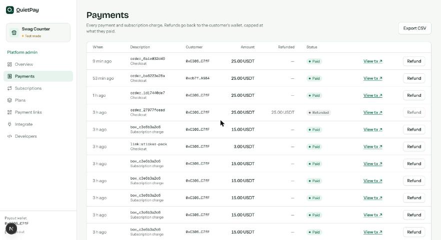
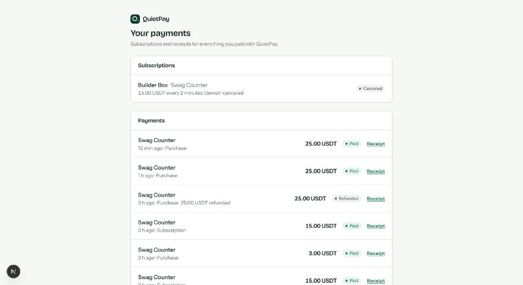
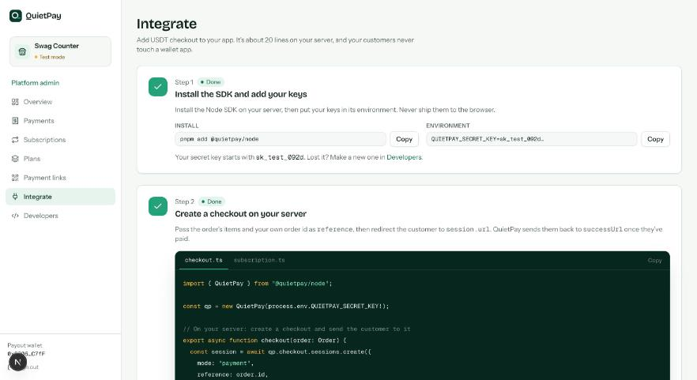

# QuietPay

**Stripe-style billing for USDT on Whitechain: checkout, payment links, subscriptions and refunds, with no gas for anyone and funds straight to the merchant's own wallet.**

Built at ETHGlobal Mumbai for Whitechain's **Operate: Stablecoin Payments for Business** track.

- **Demo video:** _link added after recording_
- **Contract (verified):** [`0x8ed9E91D00CbeB77F492863dc101C073F9152aC5`](https://explorer.testnet.whitechain.io/address/0x8ed9E91D00CbeB77F492863dc101C073F9152aC5) on Whitechain Sepolia (chain 1874)
- **Token:** the official test USDT [`0xcedfB56113143d55b2358b8CFbB0dEB5Ad2f55a7`](https://explorer.testnet.whitechain.io/address/0xcedfB56113143d55b2358b8CFbB0dEB5Ad2f55a7) for every payment
- **Evidence:** explorer links for every flow in [`docs/EVIDENCE.md`](docs/EVIDENCE.md)



## Why on-chain

QuietPay settles in USDT on Whitechain because merchants get final settlement in about a second with no chargebacks and no processor holding their money, and because signed authorizations let the payment rules (exact amount, one payment per order, refund caps, subscription limits) be enforced by a contract instead of trusted to a middleman. Card and bank rails can't give a small business that across borders.

## What Whitechain asked for, and what we built

> *"Give a business everything it needs to get paid in USDT on Whitechain, from the first checkout to what happens after it. Build a payment flow a real merchant could plug into their app or store, and show it working end to end with test stablecoins on Whitechain."*

| The brief | QuietPay |
|---|---|
| Everything a business needs to get paid | Hosted checkout, payment links with QR codes, subscriptions, refunds, receipts, signed webhooks, CSV export, a merchant dashboard |
| From the first checkout to what happens after it | Automatic renewals, failed renewals (past due, grace period, auto-cancel), partial refunds capped on-chain, customer cancellation in a portal |
| A payment flow a real merchant could plug in | **Swag Counter**, a separate demo store, adds QuietPay with ~20 lines of server code through the `@quietpay/node` SDK. Payment links and QR codes cover selling at a physical counter with no code at all. |
| End to end with test stablecoins | Every step settles in the official test USDT on Whitechain Sepolia, with explorer links |
| Not "a pay button that sends a plain transfer" | Merchant-signed invoices, signature-bound payments, a subscription state machine and refund rules, all enforced in our contract |
| Not a custodial bridge | Funds go straight to the merchant's own wallet. QuietPay never holds them. |

**Nobody pays gas.** Customers sign one EIP-712 message (USDT `receiveWithAuthorization`, EIP-3009). QuietPay's relayer submits it and pays the WBT. Customers sign in with email and an embedded wallet is created for them, so there is no wallet app, network picker or seed phrase (customers who already use MetaMask can connect it instead).

## How it works





- **Checkout:** the merchant's server creates a session; QuietPay signs an invoice with the merchant's signer key (amount, order id, expiry). The contract only accepts a payment that matches the invoice and the customer's EIP-3009 authorization, once per order.
- **Subscriptions:** the customer signs the subscription terms and a USDT permit capped at 12 periods. The keeper calls `charge()` once per period. A failed charge marks the subscription past due; after the grace period it's canceled for nonpayment.
- **Refunds:** the merchant's payout wallet signs an EIP-3009 authorization in the dashboard. The contract refunds to the original payer and never more than was paid in total.
- **Webhooks:** `payment.succeeded`, `refund.succeeded`, `subscription.created / renewed / payment_failed / canceled`, `checkout.session.completed`. HMAC-signed with a timestamp (`QuietPay-Signature: t=…,v1=…`, 5-minute tolerance in the SDK), retried with backoff, logged in the dashboard.

## Add QuietPay to a store (what Swag Counter runs)

```ts
import { QuietPay } from "@quietpay/node";
const qp = new QuietPay(process.env.QUIETPAY_SECRET_KEY!);

// On your server: create a checkout and send the customer to it
const session = await qp.checkout.sessions.create({
  mode: "payment",
  reference: order.id,
  lineItems: [{ name: "Builder Hoodie", unitAmount: "25.00", quantity: 1 }],
  successUrl: `https://yourstore.com/orders/${order.id}`,
  cancelUrl: "https://yourstore.com/cart",
});
redirect(session.url);

// Webhook route: verify, then update your order
export async function POST(req: Request) {
  const event = qp.webhooks.verify(await req.text(), req.headers.get("quietpay-signature"), process.env.QUIETPAY_WEBHOOK_SECRET!);
  if (event.type === "payment.succeeded") await markPaid(event.data.merchantReference, event.data.txHash);
  return Response.json({ received: true });
}
```

Subscriptions use the same call with `mode: "subscription"` and a `planId`. Merchants get the same code, step by step, on the dashboard's **Integrate** page.

## Tour

| Customer | Merchant |
|---|---|
|  Swag Counter, the demo store |  Dashboard overview with gas balance |
|  Hosted checkout (pop-up over the store) |  Payments, refunds and CSV export |
|  Customer portal: receipts and cancellations |  Integrate guide with the exact code |

The QuietPay team gets `/admin`: merchants joined, payments, volume, subscriptions and refunds, read live from the contract's events.

The frontend in detail (pages, pop-up checkout, local setup): [`docs/readme/frontend.md`](docs/readme/frontend.md).

## Evidence on Whitechain Sepolia

| Flow | Transaction |
|---|---|
| Deploy QuietPay | [0x02c6…2b22](https://explorer.testnet.whitechain.io/tx/0x02c6298b49bfb14b0d500941e62ba7d52ed8c9cd767000f5174cdde057d82b22) |
| Checkout payment (Swag Counter hoodie, 25.00 USDT) | [0xb069…7026](https://explorer.testnet.whitechain.io/tx/0xb0696e753e80ce40e1ac677827bc50d2a766dc65f86cea8c86a25f92971c7026) |
| Payment link (Sticker Pack QR, 3.00 USDT) | [0xca98…17c4](https://explorer.testnet.whitechain.io/tx/0xca989bc200392ebe34e1eae3be7e710272b7c9e994ec4b80639d42220d6317c4) |
| Subscribe (Builder Box, first charge) | [0x7a12…9b4f](https://explorer.testnet.whitechain.io/tx/0x7a120ed88d71504530f03c835542527830535a0380b10813013c70b61afb9b4f) |
| Automatic renewal (keeper) | [0x0007…5af0](https://explorer.testnet.whitechain.io/tx/0x000724492798b2977057cb784fdb91d44f66ea65d40f79606893f4cc28cc5af0) |
| Customer cancel from the portal | [0xa77c…cb1e](https://explorer.testnet.whitechain.io/tx/0xa77c063d4e4bd49822f63182ed78ee4a58a42816eb89583a78e80d33d8a6cb1e) |
| Partial refund (5.00 of 25.00) | [0x82ee…42d9](https://explorer.testnet.whitechain.io/tx/0x82eef7948b0fda1181af54a58fc77672d44ccf6db5965346609c1e9f7ffc42d9) |
| Full refund (25.00 of 25.00; the contract then refuses any more) | [0x8358…0401](https://explorer.testnet.whitechain.io/tx/0x83588aa150a4f04b61b4305808fb1e9731495470b60ca55dcf2785695b3f0401) |
| Pop-up checkout (Swag Counter → QuietPay window → Paid) | [0x6bc1…b7d6](https://explorer.testnet.whitechain.io/tx/0x6bc19c8cd267c91221c0e3b7b24a2c40b34567f6145219bf7ab58244e98fb7d6) |

Failed renewal, cancel for nonpayment and more: [`docs/EVIDENCE.md`](docs/EVIDENCE.md).

## Run it locally

Requirements: Node 22, pnpm 10, [Foundry](https://getfoundry.sh) for the contracts, a [Privy](https://privy.io) app (email login, allowed origin `http://localhost:3001`), and test WBT from the Whitechain faucet for the relayer.

```bash
pnpm install
pnpm test               # all TypeScript packages
pnpm test:contracts     # forge test
```

**1. Contract** (already deployed; only needed for a fresh deployment, from `contracts/`):
```bash
forge script script/Deploy.s.sol:Deploy --rpc-url $WHITECHAIN_SEPOLIA_RPC_URL --private-key $DEPLOYER_PK --broadcast
forge verify-contract <address> src/QuietPay.sol:QuietPay --rpc-url $WHITECHAIN_SEPOLIA_RPC_URL \
  --verifier blockscout --verifier-url https://explorer.testnet.whitechain.io/api/ \
  --constructor-args $(cast abi-encode "constructor(address,address)" $USDT $OWNER)
pnpm abi:export   # writes the address and ABI to packages/shared
```
Solc 0.8.30 with `evm_version = prague` (required for verification on Whitechain).

**2. API** (port 4000):
```bash
cp apps/api/.env.example apps/api/.env
#   RELAYER_PK        a relayer wallet that is an operator on QuietPay and holds test WBT
#   ENCRYPTION_KEY    openssl rand -hex 32   (encrypts merchant signer keys at rest)
#   JWT_SECRET        openssl rand -hex 24
#   SEED_PAYOUT_ADDRESS, SEED_WEBHOOK_URL, DEMO_MODE / DEMO_TREASURY_PK (optional /demo/fund)
pnpm --filter @quietpay/api seed   # registers Swag Counter on-chain; prints its keys, plan id and link URL once
pnpm dev:api
```
Run one API per relayer key at a time (two processes sharing a key will clash on nonces).

**3. Web and store** (ports 3001 and 3000): see [`docs/readme/frontend.md`](docs/readme/frontend.md#run-it-locally). In short: copy the two `.env.example` files, point them at `http://localhost:4000`, paste the keys the seed printed into the store, then `pnpm dev:web` and `pnpm dev:store`.

**Without the chain:** `pnpm dev:mock` runs a mock API on port 4010 with seeded data, and `NEXT_PUBLIC_WALLET_MODE=dev` replaces Privy with an in-browser test wallet.

## Repository

```
contracts/          QuietPay.sol, Foundry tests, deploy script
packages/shared/    chain config, ABI, deployed address, EIP-712 types, API types (zod)
packages/sdk-node/  @quietpay/node: what a merchant's server uses
apps/api/           REST API, relayer, indexer, keeper, webhook sender (Hono + SQLite)
apps/web/           hosted checkout, payment links, receipts, customer portal, merchant dashboard, team admin
apps/store/         Swag Counter demo merchant (uses @quietpay/node only)
tools/mock-api/     mock API for frontend work without the chain
scripts/            first payment, subscription and refund demos on the real chain, ABI export
docs/               plan, specs, evidence, frontend README, feedback
```

## Security model

- **The contract holds no USDT between transactions.** Each call moves funds payer → merchant (or merchant → payer for refunds) and finishes.
- **Operators can't take money.** The relayer can register merchants and plans and submit transactions, but every payment needs the customer's signature for an exact amount, and every refund needs the merchant payout wallet's signature.
- **Invoices are merchant-signed.** Amount, order id and expiry are bound by the merchant's signer key, and each order can be paid once.
- **Refunds are capped** at the amount paid, across all partial refunds, by the contract.
- **Subscriptions are capped** by the customer's permit (12 periods) and charge at most once per period.
- **Admin:** `Ownable2Step`, `Pausable`, `ReentrancyGuard` (OpenZeppelin v5). Secret keys are stored hashed, merchant signer keys encrypted at rest, webhooks HMAC-signed with a timestamp, dashboard sessions issued after a signed nonce.
- **Testnet only.** All keys in this repo's setup are test keys; never fund them with real assets.

## Limitations

- Runs on Whitechain Sepolia with test USDT only; not audited.
- One relayer per API instance, and the API uses SQLite: fine for a demo, not for scale. A production version needs a key manager (KMS/HSM) for relayer and signer keys.
- Merchants fund their own gas balance by sending WBT to the relayer; there is no automatic top-up yet.
- Customers sign in with email or Google through Privy, or connect an existing MetaMask wallet. There is no fiat on-ramp: customers need USDT in their wallet first (`/demo/fund` covers this on testnet).
- Merchants can't upload a logo yet; checkout uses the merchant site's own icon.
- The admin panel shows merchants by on-chain id; business names live in each API instance.
- Webhooks are delivered at least once; merchants must treat `event.id` as an idempotency key (Swag Counter does).

## Feedback for Whitechain

[`WHITECHAIN_FEEDBACK.md`](WHITECHAIN_FEEDBACK.md)

## Credits

Third-party assets and licenses: [`docs/readme/CREDITS.md`](docs/readme/CREDITS.md). Swag Counter is a demo merchant built at ETHGlobal Mumbai, not an official ETHGlobal store.
