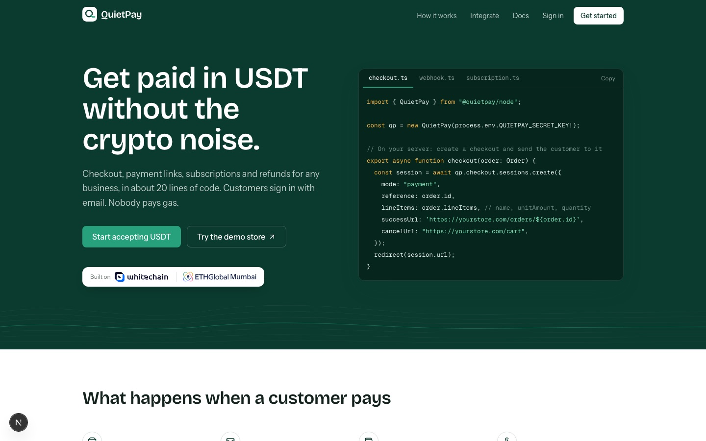
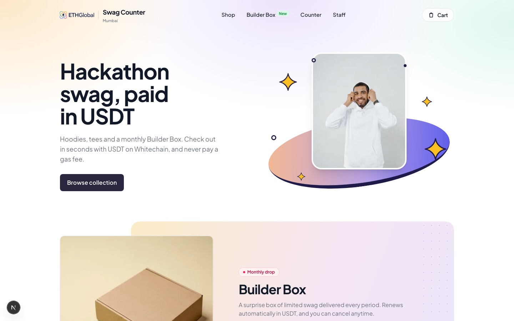
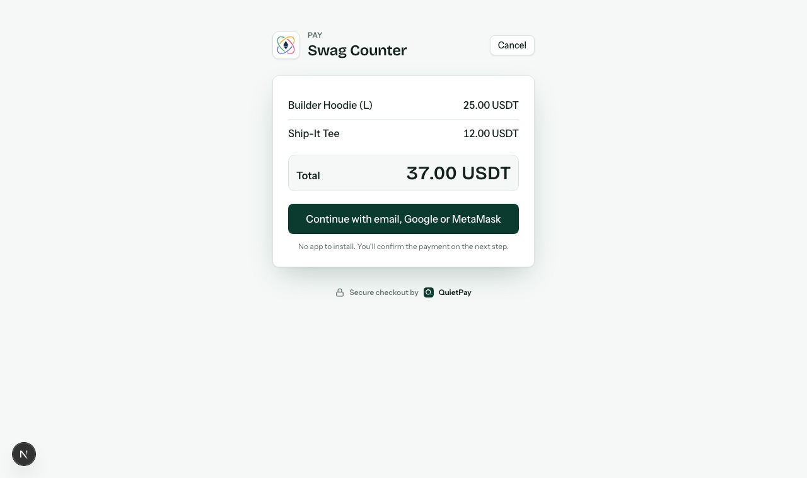
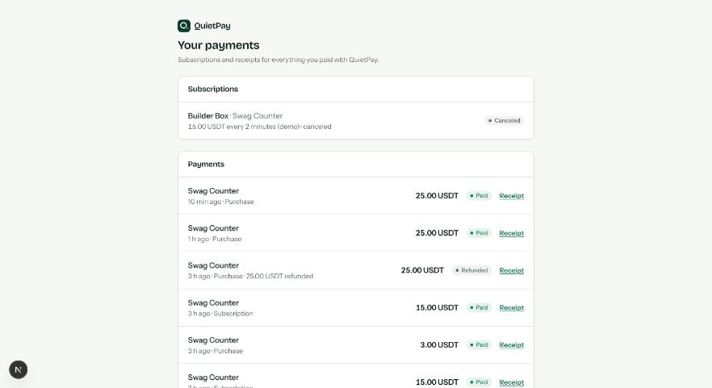
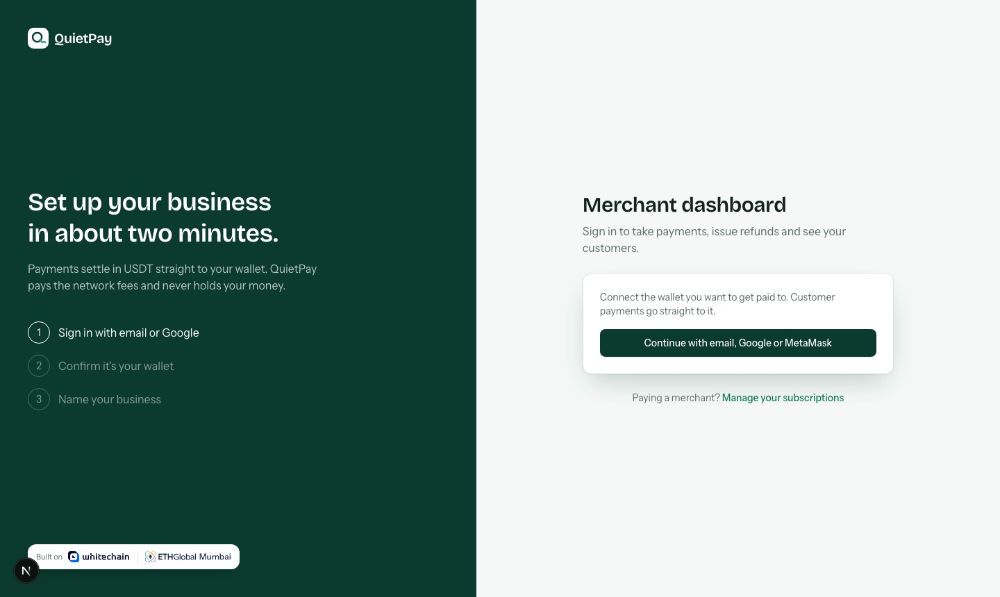
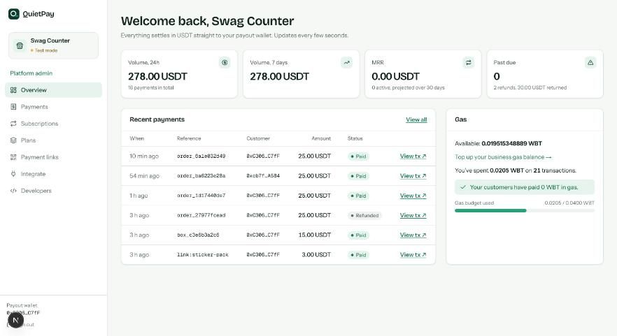
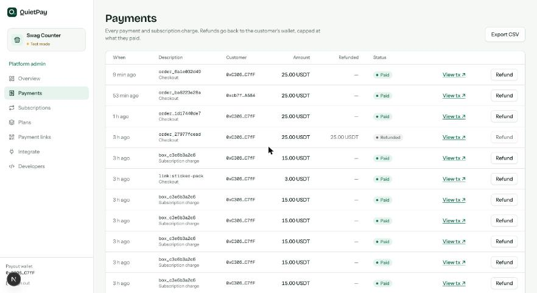
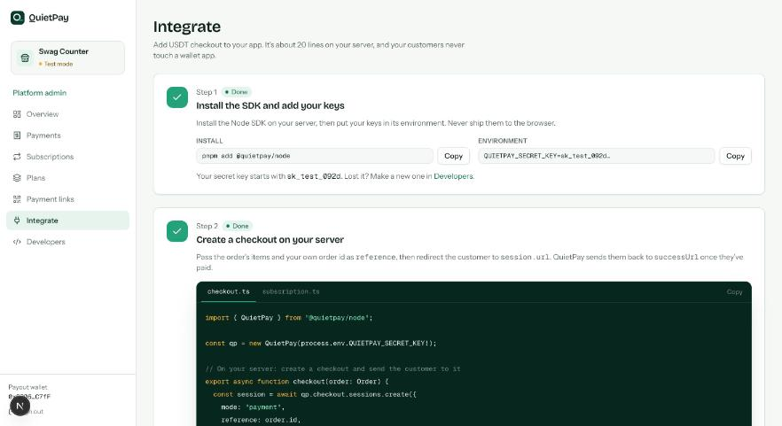
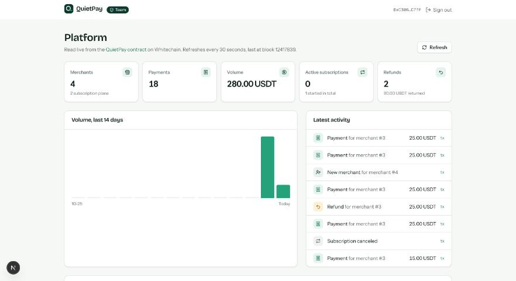

# Frontend: QuietPay web app and the Swag Counter demo store

Two Next.js apps sit on top of the QuietPay API:

| App | Folder | Port | Who uses it |
|---|---|---|---|
| **QuietPay web** | `apps/web` | 3001 | Customers (hosted checkout, payment links, receipts, portal), merchants (dashboard), the QuietPay team (`/admin`) |
| **Swag Counter** | `apps/store` | 3000 | A demo merchant: a hackathon swag store that takes USDT through QuietPay, the way any real shop would |

Swag Counter never touches a wallet, a private key or the chain. It talks to QuietPay only through the `@quietpay/node` SDK and a signed webhook, which is the whole point: a business adds stablecoin payments in about 20 lines of server code.



## What a customer sees

1. **Swag Counter:** pick a hoodie, open the cart and click **Pay with USDT**.
2. **QuietPay checkout** opens in a pop-up over the store (on phones it's a normal redirect). The customer signs in with **email** (Privy creates or reopens an embedded wallet on Whitechain), checks the items and total, and clicks **Pay**.
3. One signature authorises exactly that amount (EIP-3009 `receiveWithAuthorization` on the official USDT). QuietPay's relayer sends the transaction and pays the gas: **the customer needs no WBT and never sees a network, gas or seed phrase**.
4. The pop-up closes, the store opens the order page, and the order shows **Paid** as soon as the signed `payment.succeeded` webhook arrives.




Subscriptions (Builder Box) work the same way with two signatures: the subscription terms and a USDT permit capped at 12 periods. After that the keeper renews every period with no action from the customer. Customers see their payments and receipts, and cancel subscriptions, in the **customer portal** (`/portal`), linked as "Your orders" in the store.



## What a merchant sees

Signing up is three steps: sign in with email, confirm the wallet with one signature (no gas), name the business. Payments settle straight to that wallet; QuietPay never holds funds.



| Page | What it does |
|---|---|
| **Overview** | Volume, MRR, past-due subscriptions, refunds, recent payments, the merchant's gas balance, and a setup checklist for new merchants |
| **Payments** | Every checkout and subscription charge with explorer links; **refunds** (full or partial, signed by the payout wallet, capped on-chain at what was paid); CSV export |
| **Subscriptions** | Active, past due and canceled subscriptions with filters; cancel from the merchant side |
| **Plans** | Monthly, weekly or a 2-minute demo period, with a grace period |
| **Payment links** | A link and a printable QR code per product (used for the Sticker Pack at the counter) |
| **Integrate** | Step-by-step guide with the exact code, live done/not-done states and a "Send a test event" button |
| **Developers** | Secret key rotation, webhook URL and the webhook delivery log |

All long lists are paginated (20 rows, cursor-based) and only the first page refreshes live.





## The integration (what Swag Counter actually runs)

```ts
// apps/store/lib/quietpay.ts (server only)
import { QuietPay } from "@quietpay/node";
export const qp = new QuietPay(process.env.QUIETPAY_SECRET_KEY!);

// apps/store/app/cart/actions.ts: create a checkout for the order
const session = await qp.checkout.sessions.create({
  mode: "payment",
  reference: order.id,
  lineItems: order.lines.map((l) => ({ name: l.name, unitAmount: l.unitPrice, quantity: l.qty })),
  successUrl: `${STORE_URL}/orders/${order.id}`,
  cancelUrl: `${STORE_URL}/cart`,
});
return { url: session.url }; // opened in a QuietPay pop-up, or redirected to on phones

// apps/store/app/api/webhooks/quietpay/route.ts: mark the order paid
export async function POST(req: Request) {
  const event = qp.webhooks.verify(await req.text(), req.headers.get("quietpay-signature"), process.env.QUIETPAY_WEBHOOK_SECRET!);
  handleQuietPayEvent(event); // payment.succeeded, refund.succeeded, subscription.* (idempotent on event.id)
  return Response.json({ received: true });
}
```

Subscriptions use the same call with `mode: "subscription"` and a `planId`. The pop-up is a small client helper in the store (`apps/store/lib/quietpay-checkout.tsx`): it opens the checkout URL with `?popup=1`, and the checkout posts `{ type: "quietpay:checkout", status }` back to the store's origin before closing. The store only accepts that message from the checkout's origin and only navigates within itself. A real window is used instead of an iframe so Privy's email login works.

## The QuietPay team panel

`/admin` is limited to wallets in `NEXT_PUBLIC_ADMIN_ADDRESSES`. It reads the QuietPay contract's events directly from Whitechain (no API needed): merchants that joined, payments, volume, active subscriptions, refunds, a 14-day volume chart and the latest activity with explorer links.



## Run it locally

Prerequisites: Node 22, pnpm 10, the QuietPay API running (`pnpm dev:api`, see the main README), and a Privy app with email login enabled and `http://localhost:3001` as an allowed origin.

```bash
pnpm install

# QuietPay web (port 3001)
cp apps/web/.env.example apps/web/.env.local
#   NEXT_PUBLIC_QUIETPAY_API_URL=http://localhost:4000
#   NEXT_PUBLIC_WALLET_MODE=privy
#   NEXT_PUBLIC_PRIVY_APP_ID=<your Privy app id>
#   NEXT_PUBLIC_ADMIN_ADDRESSES=<team wallets, comma-separated>
pnpm dev:web

# Swag Counter (port 3000)
cp apps/store/.env.example apps/store/.env.local
#   QUIETPAY_API_URL=http://localhost:4000
#   QUIETPAY_SECRET_KEY / QUIETPAY_WEBHOOK_SECRET / QUIETPAY_BOX_PLAN_ID / QUIETPAY_STICKER_LINK_URL
#   (all printed once by `pnpm --filter @quietpay/api seed`)
pnpm dev:store
```

If port 3000 is taken, run the store with `STORE_URL=http://localhost:3002 pnpm --filter @swag-counter/store exec next dev -p 3002` and seed the API with `SEED_WEBHOOK_URL=http://localhost:3002/api/webhooks/quietpay`.

Without the real API, `pnpm dev:mock` starts a mock QuietPay API on port 4010 with seeded data, and `NEXT_PUBLIC_WALLET_MODE=dev` uses an in-browser test wallet instead of Privy.

The customer wallet needs test USDT on Whitechain Sepolia (no WBT). With `DEMO_MODE=true` on the API, `/demo/fund` gives 50 test USDT per wallet every 10 minutes.

## Tests

```bash
pnpm --filter @quietpay/web test     # checkout state machine, formatting, admin event parsing
pnpm --filter @swag-counter/store test   # idempotent webhook handling, order and box states
```

## Design notes

- Customer-facing pages never mention gas, WBT, chains or networks; merchant-only errors (like an empty gas balance) are rephrased for customers.
- Amounts are decimal strings from the API and are never handled as JS numbers.
- Every finished on-chain action links to the Whitechain explorer.
- The hosted checkout shows the merchant's own site icon (`/icon.svg` or `/favicon.ico` on the store's origin), falling back to the first letter of the business name.
- Brand: the QuietPay mark is a "Q" whose tail settles into a flat line. Fonts are Bricolage Grotesque and Instrument Sans; icons are Lucide. Third-party credits are in [CREDITS.md](CREDITS.md).
